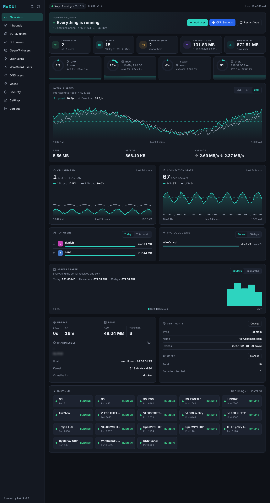
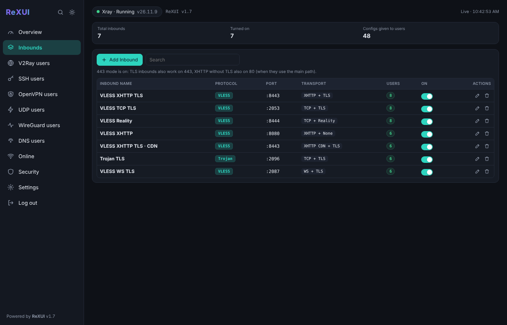
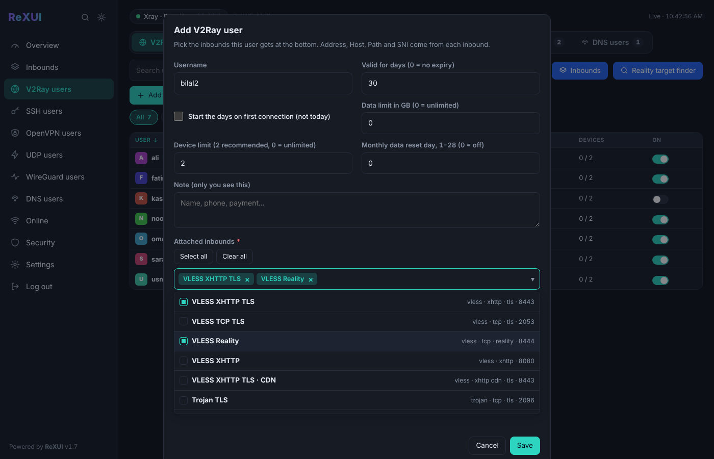
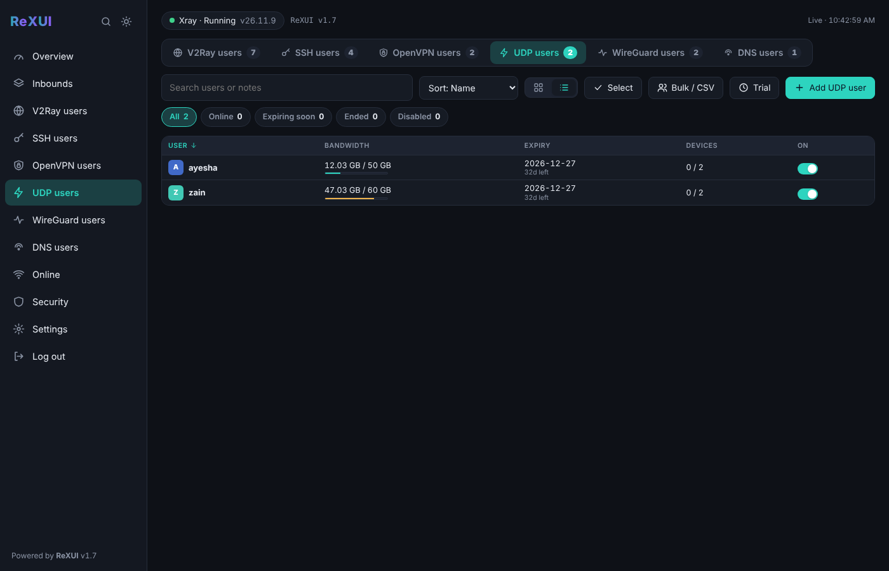
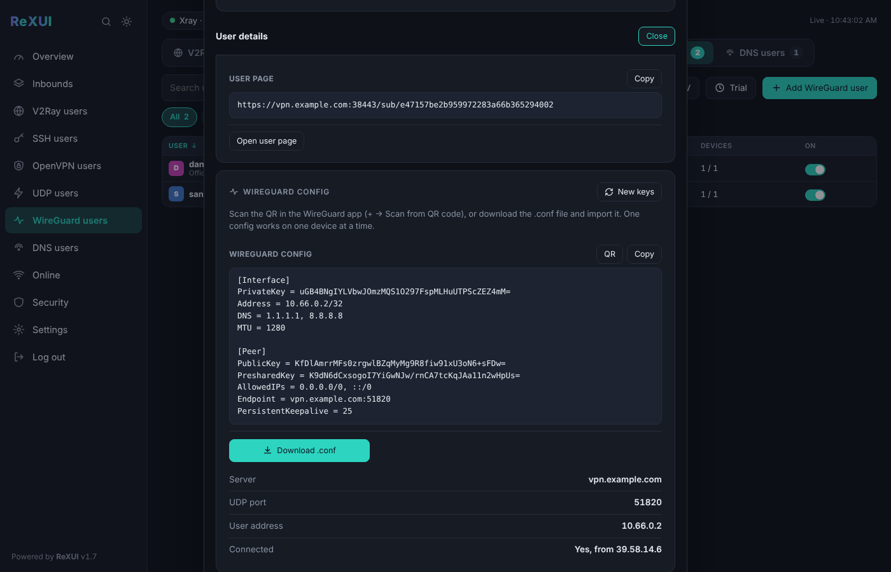
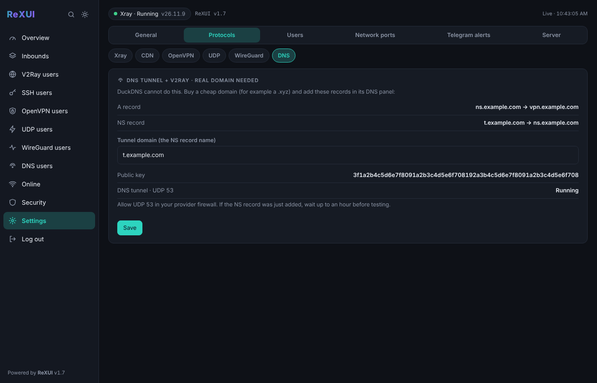
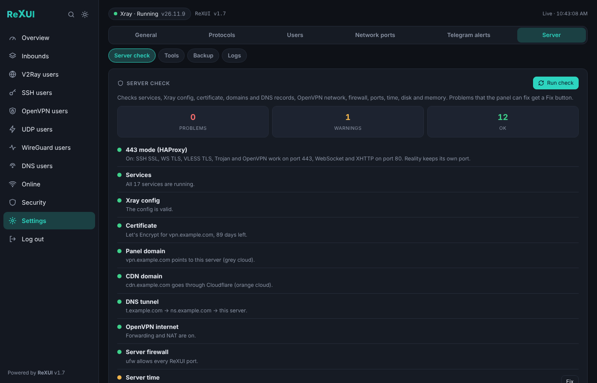
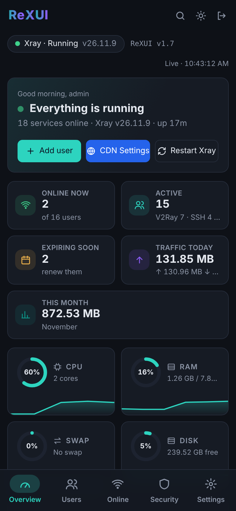
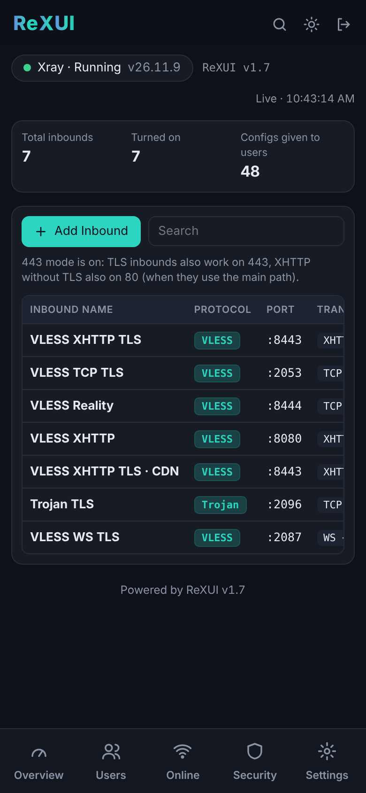

<div align="center">


[](https://github.com/alecssdeveloper1/AlecsUI)

<br/>

### 🌐 Limbă / Language

[](#-română)
[](#-english)

<br/>


<br/>


<br/>

**RO:** Un panou pentru SSH, V2Ray, OpenVPN, UDP, WireGuard și tuneluri DNS, cu instalator într-un singur fișier. Totul pe porturile **443** și **80**.  
**EN:** One panel for SSH, V2Ray, OpenVPN, UDP, WireGuard and DNS tunnels, with a one-file installer. Everything on port **443** and **80**.


</div>

<p align="center"></p>


# 🇷🇴 Română

## ✨ Noutăți în 1.9.4


- Server check: eliminat falsul **Not installed** / **Xray · Stopped** (helper bloca `systemctl show`)
- Port conflicts: `stunnel4` (binarul AlecsUI) nu mai e raportat ca străin
- Continuă 1.9.3: stunnel re-check + realocare pe 443/2083

<details>
<summary><b>🕒 Noutăți în 1.9.3</b></summary>

- Stunnel: re-check porturi + realocare automată înainte de bind (fix pe VPS cu WHM/cPanel pe 443/2083)
- `foreground = yes` + bind IPv4 explicit; retry pe Address already in use
- Continuă 1.9.2: instalator animat RO/EN, Ubuntu 20–26

</details>

<details>
<summary><b>🕒 Noutăți în 1.9.2</b></summary>

- Instalator **animat** (banner, spinner, progress) cu mesaje **RO + EN**
- Suport oficial **Ubuntu 20–26** și Debian 11+
- Continuă hardening-ul din 1.9.1 (stunnel dedicat, SSH Match Group, CSRF, supply chain)

</details>

<details>
<summary><b>🕒 Noutăți în 1.9.1</b></summary>


- Unitate dedicată **`alecsui-stunnel`** (stunnel4 străin neatins); port SSL reasignat dacă 443 e ocupat
- SSH: **`Match Group alecsui-ssh`** (fără PasswordAuthentication global)
- Uninstall pe manifest + restore SSH/stunnel străin; purge useri doar cu `DELETE-USERS`
- Digest-uri **doar de pe github.com**; BadVPN commit pin; acme.sh fără `curl|sh`
- CSRF dedicat; helper privilegiat allowlist; checks IPv4/IPv6
- Docs: `docs/SECURITY-REPORT-1.9.1.md`, matrice compatibilitate, `tests/vm/`
- **Nu Production Ready** până trec testele VM pe staging

</details>

<details>
<summary><b>🕒 Noutăți în 1.8</b></summary>

- Instalator mai inteligent: detectare VPS (OpenVZ/TUN/BBR/WireGuard)
- Fără conflict pe portul 443 la reinstalare
- Download Xray/Hysteria cu timeout + mirror-uri
- Protocoale incompatibile sunt sărite
- Branding **AlecsUI v1.8**

</details>

<details>
<summary><b>🕒 Noutăți în 1.7</b></summary>


- **Pagină Inbounds (ca 3X-UI):** creezi propriile configuri V2Ray. Alegi **VLESS sau Trojan**, portul, transportul (**TCP, XHTTP, WS, XHTTP CDN, WS CDN**) și securitatea (**None, TLS sau Reality**). Address, Host, Path și SNI se setează pe inbound
- Instalările noi încep **fără inbounds** — faci exact ce ai nevoie
- Fiecare user V2Ray primește doar inbound-urile pe care i le **atașezi**. Un inbound nou nu se adaugă singur la userii vechi
- Inbound-urile pot **împărți un port** când se potrivesc, iar un port deja folosit e afișat înainte să salvezi
- **WebSocket** pentru VLESS și Trojan, inclusiv prin Cloudflare CDN. În modul 443, WS TLS pe 443 și WS fără TLS pe 80
- **Tabele compacte:** inbound-uri și useri pe rânduri subțiri, cu switch on/off. Atingi un user pentru detalii și editare
- **Teal** e culoarea implicită (restul în Settings → Appearance)
- Butonul **Back** din browser navighează înapoi în panou

**🔐 Securitate**
- Xray rulează ca user separat (`alecsui-xray`), celelalte servicii nu îi pot citi cheile sau configul
- Download-urile Xray (installer, meniu, update panou) sunt verificate cu checksum oficial. Dacă verificarea eșuează, nu se schimbă nimic
- **Restore** verifică fiecare user din backup și sare peste cei corupți (îți spune câți)
- Un user nu e creat dacă parola nu a putut fi setată
- Înregistrările vechi de login eșuat se curăță în fiecare minut

<details>
<summary><b>🕒 Ce era nou în 1.6 și 1.5</b></summary>

- **1.6:** useri WireGuard (chei proprii, QR, .conf), generator payload pe SSH, IP real pentru SSH, adresa CDN păstrată la restore
- **1.5:** modul 443 (HAProxy) cu self-test și rollback, IP client real în spatele HAProxy, CDN mode, payload builder, Server check cu butoane Fix, pagina Ports, Performance mode, Settings în 6 tab-uri, „No expiry” din Edit

</details>
</details>

## 🚀 Instalare

<p align="center">
  
  
  
</p>

### Cerințe

| | Minim | Recomandat |
|---|---|---|
| OS | Ubuntu 20–26 / Debian 11+ | Ubuntu 22.04 / 24.04 LTS |
| Virt | OpenVZ/LXC (funcții limitate) | **KVM** |
| RAM | 1 GB | 2 GB+ |
| Disk | 10 GB | 20 GB+ |
| Root | obligatoriu | + chei SSH pentru root |

**Limitări OpenVZ/LXC:** fără TUN → OpenVPN **NOT SUPPORTED**; fără modul WireGuard → WG **NOT SUPPORTED**; BBR poate lipsi. SSH / WS / V2Ray / Hysteria2 de obicei funcționează.

Rulează ca **root** pe un VPS dedicat (nu pe mașina ta de producție amestecată cu alte stack-uri critice fără backup):

```bash
# Preferat: release versionat (după publicarea tag-ului v1.9.0)
# curl -fsSL -o install.sh https://github.com/alecssdeveloper1/AlecsUI/releases/download/v1.9.0/install.sh
# sha256sum -c install.sh.sha256
# bash install.sh

# Sau (dev / până există release):
bash <(curl -fsSL https://raw.githubusercontent.com/alecssdeveloper1/AlecsUI/main/install.sh)
```

La final primești **adresa panoului** și **login-ul**. Salvează-le imediat (nu rămân în fișier plaintext).  
Apoi tastează `menu` pe server.

Dacă rulezi installer-ul din nou: **upgrade** cu păstrarea userilor, setărilor și certificatelor (+ backup automat în `/root/alecsui-preinstall-*`).

După instalare: **Inbounds** → creează configurile V2Ray → atașează-le userilor.

### Porturi de deschis la provider

- **TCP:** SSH, SSL/443, WS, WS-TLS, panel (aleator), OpenVPN, Squid, 80 (Let's Encrypt / 443 mode)
- **UDP:** Hysteria2 (ex. 443), hop range, WireGuard (51820), DNS 53  
UDP 443 ≠ TCP 443 — sunt protocoale diferite.

### Administrare rapidă

| Acțiune | Cum |
|---|---|
| Panou | URL afișat la instalare (`https://IP:PORT/path/`) |
| Meniu | `menu` ca root |
| SSL domeniu | `menu` → 7 (Let's Encrypt) |
| Backup | `menu` → 8 sau panou → Backup |
| Update | `menu` → 9 (Releases + SHA256) |
| Server check | `menu` → 10 |
| Uninstall | `menu` → 1 (cere `yes`, face backup înainte) |

Politica de securitate: [SECURITY.md](SECURITY.md). Licență: GPL-3.0 (fork modificat din ReXUI — vezi [NOTICE](NOTICE)).

## 🔥 Funcții

**👥 Useri, câte un tab pe protocol**
- **V2Ray:** toate inbound-urile atașate într-un singur link de subscription
- **SSH:** SSH, SSL, WebSocket, UDPGW, cu payload-uri gata
- **OpenVPN:** certificat propriu per user, download `.ovpn` cu port, HTTP proxy și Host (bug host)
- **UDP:** Hysteria2 cu port hopping, parolă proprie, limită de viteză per user
- **WireGuard:** chei și adresă proprii, QR + `.conf`, un device per config
- **DNS:** V2Ray în tunel DNS (dnstt), pentru rețele unde e deschis doar DNS. *Ai nevoie de domeniu propriu.*
- Buton Add + trial (1 zi / 2 GB) pentru fiecare tip
- Limită date, expirare, limită device (recomandat 2), reset lunar, expirare de la prima folosire
- Disable cu motiv, clone, note, acțiuni bulk, export/import CSV
- Card share cu QR pentru WhatsApp, link / UUID / certificat nou dintr-un tap

**🧩 Inbounds (V2Ray)** · **🛡️ Modul 443 (HAProxy)** · **☁️ CDN și payload-uri** · **⚡ Optimizat pentru mulți useri** · **🖥️ Panou PWA** · **🧰 Server check, backup, Telegram**

## 🔌 Porturi implicite

| Serviciu | Modul 443 | Port propriu |
|---|---|---|
| SSH | | 22 |
| SSH SSL / TLS | **443** | |
| SSH WebSocket | **80** | 8880 |
| SSH WebSocket TLS | **443** | 2083 |
| V2Ray TLS | **443** | portul ales de tine |
| V2Ray XHTTP / WS fără TLS | **80** | portul ales de tine |
| V2Ray Reality | | portul ales de tine |
| OpenVPN TCP | **443** | 1194, 110 |
| HTTP proxy OpenVPN (Squid) | | 3128 |
| Hysteria2 (UDP) | | 443/udp + 20000-30000/udp |
| WireGuard (UDP) | | 51820/udp |
| Tunel DNS | | 53/udp |
| UDPGW | | 7300 (local) |
| Website | **80**, 443 | |
| Panou | | random (afișat după instalare) |

Deschide aceste porturi în firewall-ul providerului. Porturile se schimbă din `menu`.

> **Merge pe server, dar nu din exterior?** Mulți provideri au reguli Anti-DDoS pe port. O regulă care așteaptă **SSH** pe 80/8080/8880 lasă doar SSH și blochează WebSocket/XHTTP. Pune-le pe **HTTP** sau șterge-le.

## 📱 Aplicații client

| Useri | Aplicații |
|---|---|
| V2Ray | [v2rayNG](https://github.com/2dust/v2rayNG/releases/latest), [NekoBox](https://github.com/MatsuriDayo/NekoBoxForAndroid/releases/latest), [Hiddify](https://github.com/hiddify/hiddify-app/releases/latest), NPV Tunnel |
| SSH | HTTP Custom, HTTP Injector, NPV Tunnel |
| OpenVPN | [OpenVPN Connect](https://openvpn.net/client/), HTTP Custom |
| UDP (Hysteria2) | v2rayNG, NekoBox, Hiddify, NPV Tunnel |
| WireGuard | [WireGuard](https://www.wireguard.com/install/), Hiddify, NekoBox |
| DNS + V2Ray | HTTP Custom (SlowDNS), NPV Tunnel (DNSTT) |

## 🌐 Setup tunel DNS

DuckDNS nu merge aici. Folosește un domeniu propriu cu DNS pe Cloudflare (sau orice host cu înregistrări **NS**):

| Tip | Nume | Valoare |
|---|---|---|
| A | `ns` | IP-ul serverului |
| NS | `t` | `ns.domeniultau.com` |

Apoi setează `t.domeniultau.com` în **Settings → DNS** și deschide **UDP 53**.  
Pe Cloudflare lasă norul **gri (DNS only)**.

## 🧡 Setup CDN (Cloudflare)

| Tip | Nume | Valoare | Nor |
|---|---|---|---|
| A | `cdn` | IP-ul serverului | **portocaliu (Proxied)** |

Cloudflare → SSL/TLS → modul **Full**. Apoi `cdn.domeniultau.com` în **Settings → CDN**.  
Panoul și înregistrările DNS tunnel rămân **gri**.

## 💻 Meniu terminal

```bash
menu
```

Dezinstalare, info panou, reset login (oprește și 2FA), schimbare porturi, restart servicii, certificat SSL, backup/restore, update AlecsUI / Xray, Server check, Performance mode, modul 443 on/off.

## 💡 Sfaturi

- Point un domeniu la VPS (A record, nor gri) și ia certificat Let's Encrypt din `menu`
- Limită device 2 e ideală pentru majoritatea (telefon + încă unul)
- Pentru mulți useri: VPS cu 2+ cores (OpenVPN folosește fiecare core)
- WireGuard are nevoie de VPS KVM
- Schimbă path-ul panoului din **Settings → General** dacă află altcineva
- Probleme? Rulează **Settings → Server check** (sau `menu` → Server check)

<p align="right"><a href="#-limbă--language">⬆️ Sus / Top</a></p>


# 🇬🇧 English

## ✨ What's new in 1.9.4


- Server check: fixed false **Not installed** / **Xray · Stopped** (helper blocked `systemctl show`)
- Port conflicts: AlecsUI `stunnel4` binary no longer flagged as foreign
- Continues 1.9.3: stunnel re-check + reassign on busy 443/2083

<details>
<summary><b>🕒 What's new in 1.9.1 / 1.8 / 1.7 / 1.6 / 1.5</b></summary>

- **1.9.1:** dedicated `alecsui-stunnel`, SSH Match Group, manifest uninstall, official digests, CSRF, helper


- **1.8:** smarter installer, 443 reinstall fix, mirrors, skip unsupported protocols
- **1.7:** Inbounds page (3X-UI style), attach inbounds per user, WebSocket CDN, compact tables, hardened Xray user + checksums
- **1.6:** WireGuard users (own keys, QR, .conf), payload generator on SSH users, real IP for SSH users, CDN address kept on restore
- **1.5:** 443 mode (HAProxy) with self test and rollback, CDN mode, payload builder, server check, Ports page, Performance mode

</details>

## 📸 Screenshots

<p align="center">
  
  
  
</p>

| Inbounds | Add inbound |
|---|---|
|  |  |
| **V2Ray users** | **Add V2Ray user (attach inbounds)** |
|  |  |
| **User details** | **Dashboard (light)** |
|  |  |
| **SSH users** | **UDP users (Hysteria2)** |
|  |  |
| **OpenVPN user (.ovpn + bug host)** | **WireGuard user (QR + .conf)** |
|  |  |
| **Who is online** | **Settings: General** |
|  |  |
| **DNS tunnel settings** | **CDN mode (Cloudflare)** |
|  |  |
| **Payload builder** | **Server check** |
|  |  |
| **Ports and 443 mode** | **Login** |
|  |  |

| Phone: dashboard | Phone: users | Phone: inbounds | User's own page |
|---|---|---|---|
|  |  |  |  |

<sub>Screenshots use demo data. / Screenshot-urile folosesc date demo.</sub>


## 🚀 Install

<p align="center">
  
  
  
</p>

### Requirements

| | Minimum | Recommended |
|---|---|---|
| OS | Ubuntu 20–26 / Debian 11+ | Ubuntu 22.04 / 24.04 LTS |
| Virt | OpenVZ/LXC (limited) | **KVM** |
| RAM | 1 GB | 2 GB+ |
| Disk | 10 GB | 20 GB+ |
| Root | required | + SSH keys for root |

**OpenVZ/LXC limits:** no TUN → OpenVPN **NOT SUPPORTED**; no WireGuard module → WG **NOT SUPPORTED**; BBR may be missing. SSH / WS / V2Ray / Hysteria2 usually still work.

```bash
# Preferred: versioned release (after tag v1.9.0 is published)
# curl -fsSL -o install.sh https://github.com/alecssdeveloper1/AlecsUI/releases/download/v1.9.0/install.sh
# sha256sum -c install.sh.sha256 && bash install.sh

# Or (dev / until a release exists):
bash <(curl -fsSL https://raw.githubusercontent.com/alecssdeveloper1/AlecsUI/main/install.sh)
```

Save the panel URL and password immediately (not kept as plaintext on disk). Then run `menu`.

Re-running the installer upgrades in place and keeps users/settings/certs (auto backup under `/root/alecsui-preinstall-*`).

Security policy: [SECURITY.md](SECURITY.md). License: GPL-3.0 (modified ReXUI fork — see [NOTICE](NOTICE)).


## 🔥 Features

**👥 Users, one tab per protocol**
- **V2Ray users:** every attached inbound in one subscription link
- **SSH users:** SSH, SSL, WebSocket, UDPGW, with ready payloads
- **OpenVPN users:** own certificate per user, .ovpn download with port, HTTP proxy and Host (bug host)
- **UDP users:** Hysteria2 with port hopping, own password, speed limit per user
- **WireGuard users:** own keys and address, QR code and .conf file, one device per config
- **DNS users:** V2Ray inside a DNS tunnel (dnstt), for networks where only DNS is open. *Needs your own domain.*
- Every type has its own add button and trial (1 day / 2 GB)
- Data limit, expiry, device limit (2 recommended), monthly reset, expiry from first use
- Disable with a reason, clone, notes, bulk actions (add days, device limit, reset, disable, delete), CSV export / import
- Share card image with QR for WhatsApp, new link / UUID / certificate in one tap

**🧩 Inbounds (V2Ray)**
- VLESS or Trojan on any port, TCP / XHTTP / WS, None / TLS / Reality, Cloudflare CDN for XHTTP and WS
- Address, Host, Path and SNI per inbound, on/off switch, edit and delete
- Attach inbounds to each user, select all / clear all

**🛡️ 443 mode (HAProxy)**
- TLS protocols on **443** (SSH SSL, WS TLS, V2Ray TLS inbounds, OpenVPN), plain WebSocket and V2Ray XHTTP / WS without TLS on **80**
- Works with any SNI, the old ports stay open as a second choice, users see both
- Checks itself on start, rolls back if a check fails, watchdog restarts it or turns it off and tells you on Telegram
- One button in **Settings → Network ports**, or `menu` → 443 mode

**☁️ CDN and payloads**
- **CDN mode:** XHTTP and WS inbounds through Cloudflare (orange cloud). Server IP stays hidden
- **CDN address per user**, **Payload builder** with presets and live preview
- Test a payload on the server in one tap

**⚡ Built for many users** · **🖥️ Panel (PWA, themes, 2FA)** · **🧰 Server tools (Telegram, backup, Server check, Ports, BBR)**

## 🔌 Default ports

| Service | 443 mode | Own port (also works) |
|---|---|---|
| SSH | | 22 |
| SSH SSL / TLS | **443** | |
| SSH WebSocket | **80** | 8880 |
| SSH WebSocket TLS | **443** | 2083 |
| V2Ray inbounds with TLS | **443** | the port you choose |
| V2Ray XHTTP / WS without TLS | **80** | the port you choose |
| V2Ray Reality | | the port you choose |
| OpenVPN TCP | **443** | 1194, 110 |
| HTTP proxy for OpenVPN (Squid) | | 3128 |
| Hysteria2 (UDP) | | 443/udp + 20000-30000/udp (port hopping) |
| WireGuard (UDP) | | 51820/udp |
| DNS tunnel | | 53/udp |
| UDPGW | | 7300 (local) |
| Website | **80**, 443 | |
| Panel | | random (shown after install) |

Open these ports in your VPS provider's firewall. Ports can be changed from `menu`.

> **Works on the server but not from outside?** Many providers have **Anti-DDoS rules per port**. A rule that expects **SSH** on a web port (80, 8080, 8880) lets only SSH through and silently drops WebSocket and XHTTP. Set those rules to **HTTP**, or delete them.

## 📱 Client apps

| Users | Apps |
|---|---|
| V2Ray | [v2rayNG](https://github.com/2dust/v2rayNG/releases/latest), [NekoBox](https://github.com/MatsuriDayo/NekoBoxForAndroid/releases/latest), [Hiddify](https://github.com/hiddify/hiddify-app/releases/latest), NPV Tunnel |
| SSH | HTTP Custom, HTTP Injector, NPV Tunnel and other SSH / SSL / WebSocket apps |
| OpenVPN | [OpenVPN Connect](https://openvpn.net/client/), HTTP Custom |
| UDP (Hysteria2) | v2rayNG, NekoBox, Hiddify, NPV Tunnel |
| WireGuard | [WireGuard](https://www.wireguard.com/install/) (Android, iPhone, PC), Hiddify, NekoBox |
| DNS + V2Ray | HTTP Custom (SlowDNS, Type Auto), NPV Tunnel (DNSTT) |

## 🌐 DNS tunnel setup

DuckDNS cannot do this. Use your own domain with DNS on Cloudflare (or any DNS host that has **NS** records):

| Type | Name | Value |
|---|---|---|
| A | `ns` | your server IP |
| NS | `t` | `ns.yourdomain.com` |

Then set `t.yourdomain.com` in **Settings → DNS** and open **UDP 53**.  
On Cloudflare keep the cloud **grey (DNS only)**.

## 🧡 CDN setup (Cloudflare)

| Type | Name | Value | Cloud |
|---|---|---|---|
| A | `cdn` | your server IP | **orange (Proxied)** |

Cloudflare → SSL/TLS → mode **Full**. Then type `cdn.yourdomain.com` in **Settings → CDN**.  
Keep the panel record and the DNS tunnel records **grey**.

## 💻 Terminal menu

```bash
menu
```

Uninstall, panel info, panel login reset (also turns off 2FA), port change, service restart, SSL certificate, backup and restore, update AlecsUI / Xray, server check, performance mode, 443 mode on / off.

## 💡 Tips

- Point a domain to your VPS (A record, grey cloud on Cloudflare) and get a Let's Encrypt certificate from `menu`
- Device limit 2 works best for most people
- For lots of users pick a VPS with 2+ CPU cores
- WireGuard needs a KVM VPS
- Change the panel path in **Settings → General** if anyone else learns it
- Something not working? Run **Settings → Server check** first

<p align="right"><a href="#-limbă--language">⬆️ Top / Sus</a></p>


---

## 👨‍💻 Made by / Creat de

<div align="center">

### Alecs
[@alecssdeveloper1](https://github.com/alecssdeveloper1)


<br/>

**RO:** AlecsUI este un fork redenumit al [ReXUI](https://github.com/chaliraza777/ReXUI) de Ali ([@chaliraza777](https://github.com/chaliraza777)), păstrat sub GPL-3.0 cu credit original.  
**EN:** AlecsUI is a renamed fork of [ReXUI](https://github.com/chaliraza777/ReXUI) by Ali ([@chaliraza777](https://github.com/chaliraza777)), kept under GPL-3.0 with original credit.

</div>

### ☕ Donează / Donate

<p align="center">
  <a href="https://wise.com/pay/me/alexandrup104"></a>
  <a href="https://revolut.me/alecss12"></a>
</p>

### 📞 Contact

<p align="center">
  <a href="https://wa.me/40732159658"></a>
  <a href="https://t.me/alecss12"></a>
</p>

---

## 📜 License / Licență

**RO:** AlecsUI este software liber sub **GNU General Public License v3.0**. Poți folosi, studia, partaja și modifica. Dacă publici o versiune modificată, trebuie să rămână GPL-3.0, cu sursa publică, și să păstrezi creditul proiectului original ReXUI și al acestui fork.

**EN:** AlecsUI is free software under the **GNU General Public License v3.0**. You can use, study, share and change it. If you share a changed version, it must stay under GPL-3.0 with its source code public, and keep the credit to the original ReXUI project and this fork.

© 2026 Alecs ([alecssdeveloper1](https://github.com/alecssdeveloper1))  
Based on ReXUI © 2026 Ali ([chaliraza777](https://github.com/chaliraza777))

> **RO:** Folosește AlecsUI doar unde este legal și respectă termenii providerului VPS.  
> **EN:** Use AlecsUI only where it is legal, and follow your VPS provider's terms.


